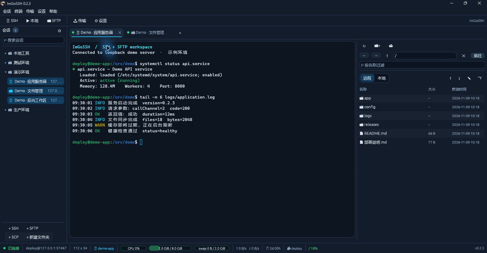
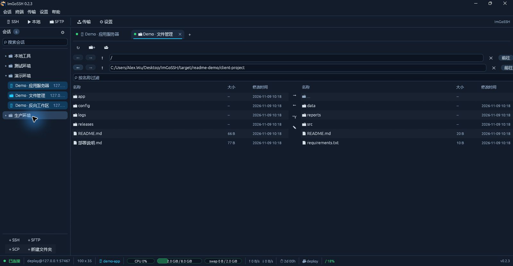
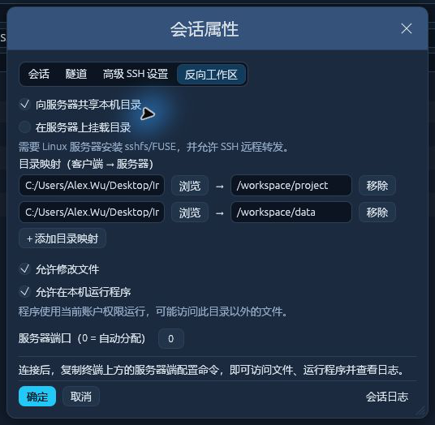
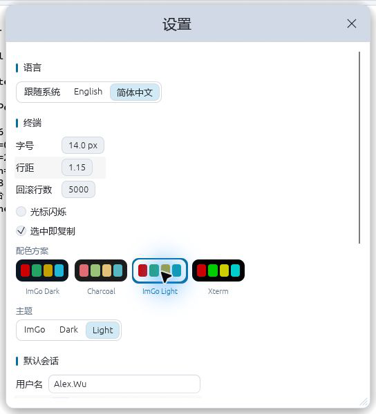

# ImGoSSH

[](https://github.com/0alexwu0/ImGoSSH/releases/latest)
[](https://github.com/0alexwu0/ImGoSSH/actions/workflows/release.yml)
[](LICENSE)
[](https://www.rust-lang.org/)

**ImGoSSH 是一个用 Rust 编写的原生 SSH / SFTP / SCP 工作站。**

在一个窗口里连接服务器、查看日志、管理文件和运行任务。ImGoSSH 集成多标签终端、会话管理、SFTP 文件浏览器、传输队列、SSH 隧道和反向工作区，同时提供三个 OpenSSH 风格的命令行工具。

| 工作场景 | 功能 |
| --- | --- |
| 连接与排障 | SSH / 本地终端、多标签切换、会话分组与搜索、中英文混排和彩色日志 |
| 部署与文件管理 | 远程 / 本地双栏 SFTP、文件夹递归上传下载、逐文件进度和取消、远程权限编辑 |
| 服务器调用本机资源 | 多目录反向工作区、Linux sshfs 挂载、本机任务执行、日志与退出码 |
| 连接基础设施 | 本地 / 远程 / SOCKS5 隧道、JumpServer SSH / SFTP 接入、服务器状态监控 |
| 日常使用 | 中英文界面、三套界面主题、四套终端配色、可选会话文件加密、内置更新 |

包含以下程序：

- `imgossh`：图形客户端
- `igssh`：交互式 SSH shell 或单条远程命令
- `igscp`：本地与远程之间的文件复制
- `igsftp`：交互式 SFTP 命令行



*功能界面：左侧管理会话，中间查看中英文彩色日志，右侧浏览 SFTP 文件，底部显示服务器状态。截图使用本地演示 SSH / SFTP 服务，日志、文件和监控指标均为示例数据。*

GUI 与 CLI 共用 `src/ssh`、`src/terminal` 和配置代码。连接、认证、主机密钥和文件传输因此保持一致。

[下载](#下载) · [功能截图](#功能截图) · [开始使用](#开始使用) · [反向工作区](#反向工作区) · [GUI 功能](#gui-功能) · [命令行工具](#命令行工具) · [源码构建](#从源码构建) · [配置](#配置与数据) · [开发与测试](#测试)

## 功能截图

### 远程与本地双栏文件管理

SFTP 可以作为独立标签页打开，也可以停靠在终端右侧。双栏界面用于浏览远程与本地目录，支持上传、下载、拖放、目录操作及文件属性查看。



### 多目录反向工作区

为每个客户端目录设置服务器路径，并分别控制文件修改和本机程序执行权限。启用挂载需要服务器具备 sshfs/FUSE；连接后可通过 GUI 或服务器端 `igworkspace` 提交本机任务、查看日志并取消任务。



### 界面主题与终端配色

界面主题和终端调色板可以独立选择，字号、行距和回滚行数可调整。下图展示 Light 界面主题与 ImGo Light 终端配色。



## 下载

最新版本：[v0.3.4](https://github.com/0alexwu0/ImGoSSH/releases/tag/v0.3.4)

| 平台 | 安装包 | 运行方式 |
| --- | --- | --- |
| Windows x86-64 | [ZIP](https://github.com/0alexwu0/ImGoSSH/releases/download/v0.3.4/ImGoSSH-0.3.4-windows-x64.zip) | 解压后运行 `imgossh.exe` |
| Linux x86-64 | [tar.gz](https://github.com/0alexwu0/ImGoSSH/releases/download/v0.3.4/ImGoSSH-0.3.4-linux-x86_64.tar.gz) | 解压后执行 `./imgossh` |
| macOS Apple Silicon | [ZIP](https://github.com/0alexwu0/ImGoSSH/releases/download/v0.3.4/ImGoSSH-0.3.4-macos-aarch64.zip) | 解压后执行 `./imgossh` |
| macOS Intel | [ZIP](https://github.com/0alexwu0/ImGoSSH/releases/download/v0.3.4/ImGoSSH-0.3.4-macos-x86_64.zip) | 解压后执行 `./imgossh` |

每个压缩包都包含图形客户端、`igssh`、`igscp`、`igsftp`、`LICENSE`、`README.md`、使用文档、JumpServer 连接器和反向工作区辅助脚本。Release 页面同时提供 SHA-256 校验值。

Linux 版本面向 glibc 2.35 及以上环境。macOS 版本目前没有开发者签名和公证，首次运行时可能需要在「系统设置 → 隐私与安全性」中允许打开，或执行：

```bash
xattr -dr com.apple.quarantine <解压目录>
```

## v0.3.4 更新

- Windows 下 JumpServer 的 SSH/SFTP 连接复用已运行的 ImGoSSH 窗口，新建并选中标签页，恢复最小化窗口。
- 支持窗口初始化期间接收连接及并发唤起；接收窗口关闭后，其他已打开窗口可接管后续连接。
- 临时连接参数通过本机命名管道转交，不写入磁盘；手动启动多个窗口的行为保留。

详细说明见 [v0.3.4 发布说明](docs/release-0.3.4.md)。升级后请重启已有窗口，使其具备接收连接的能力。

## v0.3.3 更新

- 新增 Classic 终端配色，提供深灰背景和高饱和的青色、绿色、黄色。
- 默认使用系统等宽字体，保留框线、方块和中文字符的字体回退。
- 修正 ANSI 反色时默认前景、背景及粗体颜色的解析，改善终端菜单和表头的可读性。
- 原生 Windows 标题栏随主题变化：Win11 使用主题颜色，Win10 使用系统深色或浅色标题栏。

详细说明见 [v0.3.3 发布说明](docs/release-0.3.3.md)。Win10 的标题栏绘制、输入和高 DPI 表现仍需实机确认。

## v0.3.2 更新

- 恢复系统原生标题栏，撤回自绘标题栏、无边框缩放热区和反复刷新原生框架，针对 Win10 界面抖动问题。
- 关闭 Windows 原生窗口主题同步；Win10 启动时清除窗口库的深色样式覆盖，使用标准浅色标题栏，应用内部主题继续保留。
- 修正输入法候选窗口定位，将候选排除区域限制在终端光标，保留非英文输入与 SSH 连接后自动聚焦。

详细说明见 [v0.3.2 发布说明](docs/release-0.3.2.md)。Win10 的点击、输入和高 DPI 显示仍需实机确认。

## v0.3.1 更新

- SSH shell 就绪后自动聚焦终端，切换标签页后可直接输入。
- 支持中文、日文、韩文等输入法预编辑和 UTF-8 输入，候选窗口跟随终端光标，选字回车不会误执行远端命令。
- 统一主字体与中文回退字体的文字基线，修正中英文混排时上下错位。
- 更新 README 与功能截图，展示 SSH、SFTP 双栏文件管理、反向工作区和外观设置。

详细说明见 [v0.3.1 发布说明](docs/release-0.3.1.md)。截图拍摄版本与演示数据说明见 [截图说明](docs/screenshots/README.md)。

## v0.2.3 更新

- 新增反向工作区，可配置多个客户端目录及各自的 Linux 服务器挂载位置，例如 `E:\AI\Strata-data` → `/data/sss`。
- 支持通过 sshfs/FUSE 真实挂载，服务器编辑器和命令可以直接访问目录；缺少 sshfs 或挂载失败时保持 SSH 连接，并显示安装或错误提示。
- 新增 GUI“在本机运行”和服务器端 `igworkspace` 命令，可在客户端运行程序，读取实时日志、退出码，后台执行或取消任务。
- 服务器端运行入口只需 Shell、curl 和常见系统工具，无需 Python 或 jq；支持中文命令，日志滚动后按字节偏移继续读取。
- 修正 SSH 远程转发的目标路由，让工作区控制通道和已有远程隧道连接到指定的客户端端口。

详细说明见 [v0.2.3 发布说明](docs/release-0.2.3.md)。上一版本的 JumpServer 集成及 Windows 标题栏改进见 [v0.2.2 发布说明](docs/release-0.2.2.md)。

## 开始使用

1. 解压对应平台的安装包，启动 `imgossh`。
2. 点击「新建 SSH 会话」，填写主机、端口、用户名及认证方式，保存并连接。
3. 首次连接时核对服务器的主机密钥指纹，再决定是否信任。
4. 在终端执行命令，通过右侧 SFTP 浏览器管理文件；需要时打开传输队列查看任务。

也可以从命令行启动图形客户端：

```bash
imgossh --local
imgossh user@example.com
imgossh --sftp user@example.com
imgossh user@example.com -p 2222 -i ~/.ssh/id_ed25519
imgossh --session "Production"
```

`--session` 按已保存会话的名称查找。Windows PowerShell 中，在解压目录运行程序时需要使用 `./imgossh.exe`；三个 CLI 工具也可以加入 `PATH` 后使用。

### JumpServer 调用

支持由已安装的 JumpServer 官方客户端启动 ImGoSSH，通过堡垒机网关连接 SSH 终端或使用 SFTP 传输文件。
最低支持 JumpServer Client **v2.1.4（Windows）**：旧版通过 `config.json` 适配，
新版保留 v4.1.9 的索引插件方式，安装器按配置格式选择。
Windows 下正常打开 ImGoSSH 时会自动检查已安装客户端的 SSH 和 SFTP 配置；缺少连接配置时先关闭对应的
JumpServer 桌面客户端，备份并写入配置。两项均已配置时不关闭、不重复写入。客户端 4 秒内未正常退出时会结束对应桌面进程；由 JumpServer 唤起的连接窗口跳过自动配置。
配置位于受保护目录且无写权限时会提示失败原因，可用管理员身份重新打开。
之后重新打开 JumpServer，以 SSH 客户端方式连接资产，或以 SFTP 客户端方式浏览目录、上传和下载文件。
Windows 下已有 ImGoSSH 接收窗口时，JumpServer 连接会在该窗口中新建并选中标签页，恢复最小化窗口；否则正常启动应用。临时连接参数通过本机命名管道转交，不写入磁盘。
自定义路径、手动安装及恢复见 [JumpServer 集成说明](integrations/jumpserver/README.md)。临时连接仅保留在当前窗口内存中，
不会自动加入已保存会话；SSH 模式默认关闭附带的 SFTP 面板；SFTP 模式直接打开文件浏览器。两种模式均关闭 SSH agent 和服务器监控。

## GUI 功能

### 会话与终端

- 保存 SSH、SFTP、SCP 和本地终端会话。
- 用文件夹组织会话，支持搜索、重命名、删除和右键操作。
- 多标签终端，支持远程 shell、本地 PTY / Windows ConPTY、窗口标题、响铃、滚动回看和鼠标上报。
- 鼠标拖动选中文字时实时显示选区，支持反向拖选和跨行选择。
- 终端右键菜单在窗口边缘自动调整位置，不会被底部或右侧裁切。
- 支持 16 色、256 色、24 位真彩色、VT/ANSI 查询、OSC 颜色设置和 DEC 特殊图形字符集。
- 中文回退字体与英文使用统一基线，中文保持双列占位，混排日志和后续列位置保持对齐。

### SFTP 文件浏览器

- 终端右侧停靠远程 / 本地双栏文件浏览器；窄窗口自动切换为单栏模式。
- 浏览目录、前进后退、返回上级、刷新、新建目录、重命名、删除和属性查看。
- 文件上传、下载、另存为和拖放操作。
- 上传文件夹时递归保留目录结构；文件夹中的每个文件单独显示大小、速率、状态和进度。
- 空目录、空文件和嵌套目录都会保留；传输可以单独取消，进度列表支持滚动查看。
- 属性窗口支持查看大小、时间和权限，并可直接修改远端权限。

### 反向工作区

在 GUI 登录服务器 A 后，可以让 A 访问客户端电脑的指定目录，并在 A 的 SSH 终端提交命令，让程序在客户端执行。

1. 编辑会话 →「反向工作区」，启用共享，添加一个或多个“客户端 → 服务器”目录映射。
2. 需要真实挂载时勾选「在服务器上挂载目录」；需要编辑文件或执行程序时，分别勾选对应权限。
3. 保存并重新连接。界面显示每个目录的挂载状态，例如「已挂载 E:\AI\Strata-data:/data/sss」。
4. 点击终端上方「复制服务器端配置命令」，粘贴到服务器的 POSIX shell 执行一次；随后在同一 shell 中使用：

```sh
# 以下命令在服务器 A 的 SSH 终端输入，实际在 Windows 客户端运行
igworkspace run 'hostname; Get-Location' --cwd /data/sss
igworkspace run 'python main.py' --cwd /data/sss --timeout 600

# 后台运行后，使用返回的任务 ID 查看日志或取消
igworkspace run 'python main.py' --cwd /data/sss --detach
igworkspace logs 1 --follow
igworkspace cancel 1
```

服务器需要允许 SSH 远程 TCP 转发；真实挂载还需要 Linux、sshfs/FUSE 和挂载权限。缺少 sshfs 不会阻止 SSH 登录，运行通道仍可使用。`igworkspace` 只依赖 Shell、curl 和常见系统工具，不需要服务器安装 Python 或 jq；运行 Python 等程序时，解释器只需安装在实际执行程序的客户端电脑上。Windows 客户端使用 PowerShell，Unix 客户端使用 `/bin/sh`。

也可以点击 GUI「在本机运行」提交命令和查看日志。省略 `--cwd` 使用第一个映射目录；重新连接或打开新 shell 后需重新执行配置命令。配置命令中的 `curl --noproxy '*'` 只让本次工作区请求绕过代理，不修改服务器的代理环境变量。

详细说明：[目录挂载与接口](docs/reverse-workspace.md) · [从服务器 SSH 终端运行客户端程序](docs/server-client-execution.md)。

### 传输、隧道与监控

- SFTP 传输队列提供精确字节数、进度条、速率、状态和取消操作。
- 支持本地转发 `-L`、远端转发 `-R` 和动态 SOCKS5 转发 `-D`。
- 支持密码、公钥、ssh-agent、Windows Pageant 和键盘交互认证。
- 使用 OpenSSH `known_hosts` 格式校验主机密钥，并兼容 `~/.ssh/known_hosts`。
- 可选的服务器状态栏：CPU、内存、交换分区、网络速率、运行时间、登录用户和磁盘使用率。
- 内置更新检查，下载 Release 后校验 SHA-256，再替换本地程序。

### 外观与更新

支持简体中文和英文界面，语言默认跟随系统。设置中可切换 ImGo、Dark、Light 三套界面主题，以及 ImGo Dark、Charcoal、Classic、ImGo Light、Xterm 五套终端调色板，调整字体、字号、行距和回滚行数。Classic 提供深灰底色和高饱和的 ANSI 颜色。终端默认使用系统等宽字体，内置 Hack 作为回退，并为框线、方块等字符提供字体回退。

Windows 使用系统原生标题栏，标题栏颜色跟随应用主题：Win11 通过 DWM 将标题栏底色、标题文字和边框设为当前主题的颜色；Win10 不支持自定义标题栏颜色，ImGo、Dark 主题使用系统深色标题栏，Light 主题使用标准浅色标题栏。窗口库自带的深色样式（DarkMode_Explorer）始终关闭，避免点击标题栏后标题文字和按钮绘制异常；切换主题时只更新标题栏颜色，不移动、缩放或重绘窗口框架以外的内容。应用内的界面主题和终端配色可独立设置。

「帮助 → 检查更新」可以手动检查 GitHub Releases。自动检查默认开启，成功检查后的间隔为 6 小时，可在设置中关闭；发现更新后由用户确认下载和安装，完成后重启生效。

### 常用快捷键

| 快捷键 | 操作 |
| --- | --- |
| `Ctrl+Shift+T` | 新建本地终端 |
| `Ctrl+Shift+N` | 新建会话 |
| `Ctrl+Shift+W` | 关闭当前标签 |
| `Ctrl+Shift+C` / `Ctrl+Shift+V` | 复制 / 粘贴 |
| `Ctrl+Shift+B` / `Ctrl+Shift+H` | 显示或隐藏 SFTP 浏览器 / 会话侧栏 |
| `Ctrl+Shift+R` | 重新连接或重新打开当前会话 |
| `Ctrl+Shift+S` / `Ctrl+Shift+U` | 设置 / 传输队列 |
| `Ctrl+Tab` / `Ctrl+Shift+Tab` | 下一个 / 上一个标签 |
| `Alt+1` 至 `Alt+9`、`Alt+0` | 切换到第 1 至第 10 个标签 |

常用的 `Ctrl+C`、`Ctrl+A`、`Ctrl+L` 等组合键交给终端中的程序处理。

## 命令行工具

### `igssh`

打开远程 shell：

```bash
igssh user@example.com
igssh -p 2222 -i ~/.ssh/id_ed25519 user@example.com
```

运行单条命令：

```bash
igssh user@example.com -e "uname -a"
igssh user@example.com --exec -e "uptime"
```

SSH 隧道：

```bash
igssh -L 8080:localhost:80 user@example.com
igssh -R 9000:localhost:22 user@example.com
igssh -D 1080 user@example.com
```

常用选项包括 `-l`、`-p`、`-i`、`-w`、`-a`、`--keepalive` 和 `--term`。

共享客户端目录，默认挂载到 Linux 服务器的 `/workspace`：

```powershell
igssh user@example.com --share 'E:\AI\Strata-data' --share-write --share-exec
# 从客户端命令行提交本机程序，保持 SSH 连接直至运行完成
igssh user@example.com --share 'E:\AI\Strata-data' --share-exec --share-run 'python main.py' --share-timeout 600
```

`--share-write` 和 `--share-exec` 分别授权文件修改及本机执行；`--share-cwd` 指定工作目录，`--share-port` 指定服务器控制端口（默认自动分配）。GUI 支持配置多个目录和各自的挂载位置。

### `igscp`

上传文件或目录：

```bash
igscp -r ./build user@example.com:/tmp/
igscp -i ~/.ssh/id_ed25519 app.tar.gz user@example.com:/tmp/
```

下载文件或目录：

```bash
igscp user@example.com:/var/log/app.log ./logs/
igscp -r user@example.com:/var/log/app ./logs/
```

`-q` 可关闭进度输出。当前不支持两个远程主机之间的直接复制。

### `igsftp`

```bash
igsftp user@example.com
igsftp user@example.com -o "ls -l" -o "get app.log ./app.log"
igsftp user@example.com --batch commands.txt
```

交互提示符支持 `pwd`、`lpwd`、`cd`、`lcd`、`ls`、`get`、`put`、`mkdir`、`rmdir`、`rm`、`rename`、`stat` 和 `quit`。输入 `help` 查看命令说明；各工具的启动参数可通过 `--help` 查看。CLI 采用 OpenSSH 风格的常用参数，但不保证支持 OpenSSH 的全部选项和配置语法。

## 从源码构建

要求：

- Rust 1.95 或更新版本
- Windows：stable MSVC 工具链
- Linux：Rust 工具链和 C 编译器
- macOS：Xcode Command Line Tools

```bash
git clone https://github.com/0alexwu0/ImGoSSH.git
cd ImGoSSH

cargo run
cargo run -- --local
cargo run -- user@example.com

cargo build --release
```

Release 构建会在 `target/release/` 生成四个程序。Windows 构建会尝试使用 Windows SDK 的 `rc.exe` 将 `assets/icon.png` 编译进程序图标；找不到时会保留默认图标，不会让构建失败。

## 配置与数据

默认数据目录：

| 系统 | 目录 |
| --- | --- |
| Windows | `%APPDATA%/ImGoSSH/` |
| Linux | `~/.config/ImGoSSH/` |
| macOS | `~/Library/Application Support/ImGoSSH/` |

主要文件：

| 文件 | 内容 |
| --- | --- |
| `config.toml` | 主题、字体、回滚、默认会话、窗口状态和更新设置 |
| `sessions.toml` | 会话、文件夹、启动脚本、隧道和反向工作区映射及权限；启用加密后为加密二进制文件 |
| `known_hosts` | ImGoSSH 使用的主机密钥库 |

设置 `IMGOSSH_HOME` 可以把整个数据目录移动到其他位置，例如 U 盘。调试时设置 `RUST_LOG=debug`。

会话文件加密可在“设置 → 管理加密与密码”中启用、关闭或修改密码。首次使用时，在首次新建会话并确认保存后询问是否设置密码；已有 `sessions.toml` 的用户升级后，启动时询问一次。选择设置后立即加密当前会话文件；选择暂不加密后，可随时从设置中启用。

启用后，启动时需要密码才能读取会话。选择“暂不解锁”后仍可使用软件，但新增会话仅保留在内存中，不会写入 `sessions.toml`，也不会再次提示设置密码；之后解锁会恢复文件中的原会话列表，临时会话不会自动合并保存，已打开的连接仍可继续使用。

“保存密码”使用 Windows 凭据管理器、macOS 钥匙串或 Linux Secret Service，密码不写入 `config.toml`，凭据标识采用混淆及数据目录哈希处理。系统凭据库不可用时会提示错误，可继续手动输入密码。取消保存会删除系统凭据，后续启动恢复手动解锁。移动 `IMGOSSH_HOME` 后需重新保存自动解锁凭据。

加密使用 PBKDF2-HMAC-SHA256（600,000 次迭代、随机盐）派生密钥及 AES-256-GCM，每次保存生成新的随机 nonce 并校验文件完整性。密码无法找回，请单独妥善保管；启用自动解锁意味着当前操作系统账户可以读取密码。下列示例仅适用于未加密文件：

```toml
[[session]]
name = "Production"
folder = "Clients"
protocol = "ssh"
host = "192.0.2.10"
port = 22
username = "root"
private_key = "C:/Users/me/.ssh/id_ed25519"
use_agent = true
sftp_panel = true
keepalive = 60
startup_script = "tmux attach || tmux"

[[session.tunnels]]
kind = "local"
listen_port = 8080
remote_host = "localhost"
remote_port = 80

[session.workspace]
enabled = true
mount = true
writable = true
allow_exec = true
remote_port = 0

[[session.workspace.mappings]]
local_path = "E:/AI/Strata-data"
remote_path = "/data/sss"

[[session.workspace.mappings]]
local_path = "E:/AI/tools"
remote_path = "/data/tools"
```

## 技术架构

ImGoSSH 不依赖本机 OpenSSH、Electron 或 WebView。SSH 协议、SFTP、终端仿真和 GUI 都由 Rust 组件完成。

主要技术栈：`russh` / `russh-sftp` 负责 SSH 与 SFTP，`tokio` 负责异步任务，`vt100` 负责终端仿真，`portable-pty` 提供本地伪终端，`egui` / `eframe` 绘制原生界面，`clap` 解析命令行，`serde` / `toml` 保存配置。

| 模块 | 作用 |
| --- | --- |
| `src/ssh/client.rs` | SSH 连接 actor、认证、shell、exec、SFTP 和隧道 |
| `src/ssh/workspace.rs` | 客户端目录共享、反向 SFTP 挂载、文件 API 和本机任务执行 |
| `src/ssh/sftp.rs` | 远程目录、属性、权限和文件操作 |
| `src/ssh/transfer.rs` | 上传下载队列、逐文件进度、速率和取消 |
| `src/ssh/hostkeys.rs` | OpenSSH 主机密钥读写与匹配 |
| `src/ssh/local.rs` | 本地 PTY，Windows 使用 ConPTY |
| `src/ssh/monitor.rs` | 服务器实时指标 |
| `src/terminal.rs` | 终端仿真、按键、鼠标、剪贴板和颜色查询 |
| `src/ui/` | 会话侧栏、终端、SFTP 浏览器、设置和对话框 |
| `src/update.rs` | GitHub Release 检查、下载、校验和更新 |
| `src/bin/` | `igssh`、`igscp` 和 `igsftp` |

每条 SSH 连接由一个 Tokio actor 持有底层句柄，GUI 和 CLI 通过可复制的 `Connection` 发送操作；终端仿真与远程 SSH、本地 PTY 使用同一套逻辑。

## 测试

运行本地单元、GUI 几何和本地终端测试：

```bash
cargo fmt --all --check
cargo test --workspace --locked
```

Windows 下还可运行连接器的隔离测试（使用临时配置，不会关闭已安装的客户端）：

```powershell
powershell -NoProfile -File integrations/jumpserver/Test-Install.ps1
powershell -NoProfile -File integrations/jumpserver/Test-AutoConfigure.ps1
```

反向工作区测试使用本地模拟 SSH 服务器，覆盖目录读写、多个映射、权限与越界路径、远程转发、本机程序运行、日志、取消、超时及断线清理。Shell 集成测试会限制服务器侧的 `PATH`，确认找不到 Python、Python3 或 jq 时仍能运行；Windows 测试需要 Git for Windows，非默认安装位置可设置 `IMGOSSH_TEST_GIT`。这些测试不执行真实 Linux FUSE 挂载。

[Release 工作流](.github/workflows/release.yml) 配置了 Windows、Linux 和两种 macOS 架构的构建与打包，并为原生目标配置工作区测试；macOS Intel 使用交叉编译，不运行测试。

需要真实 SSH 服务器的测试默认忽略。配置环境变量后运行：

```powershell
$env:IMGOSSH_TEST_HOST = "your-server.example.com"
$env:IMGOSSH_TEST_USER = "root"
$env:IMGOSSH_TEST_PASS = "your-password"
$env:IMGOSSH_TEST_PORT = "22"
cargo test --test live_server -- --ignored --nocapture --test-threads=1
```

## 安全与限制

- 未启用会话文件加密时，`sessions.toml` 可能明文保存连接密码。可在设置中启用加密；共享机器上建议使用私钥、ssh-agent 或 Pageant，并关闭密码保存。
- 首次连接会校验主机密钥；指纹变化时会阻断连接并要求确认。
- 主机密钥会从应用数据目录和 `~/.ssh/known_hosts` 读取，新接受的密钥写入应用数据目录；目前不匹配 OpenSSH 的哈希主机名条目。
- 文件传输使用 SFTP 子系统，服务器需要启用 SFTP 服务。
- 反向工作区默认关闭，文件写入与本机执行分别授权。执行使用客户端当前用户的权限，工作目录不构成沙箱；仅向可信服务器启用执行权限。连接断开后取消运行中的任务，并清理共享服务。
- JumpServer 接入目前仅提供 Windows 配置适配。SSH/SFTP 已通过本地网关协议测试，真实资产权限、传输和审计仍需在实际部署中验证。
- JumpServer Client 2.1.4 的接口通过进程参数传递临时令牌，本机有相应权限的进程可能读取；旧版配置会借用 XShell / WinSCP 图标槽位，卸载可恢复。
- 因 Win10 输入时出现整页抖动，已撤回标题栏配色和自绘改动，恢复系统原生窗口；恢复后的显示效果仍需在原 Win10 环境确认。
- 当前不包含 X11、RDP、VNC、FTP、Telnet 或串口功能。
- 文件浏览器不会自动跟随终端中的 `cd`。
- Linux 和 macOS 已通过自动化构建与测试，但不同桌面环境的字体、剪贴板和文件对话框仍可能存在差异。

## 参与贡献

欢迎提交 Issue 和 Pull Request。提交前建议运行：

```bash
cargo fmt --all --check
cargo clippy --all-targets
cargo test --workspace
```

新增功能或修复终端、主机密钥、路径和传输逻辑时，请同时补充回归测试；配置格式、快捷键或界面行为变化时，请同步更新 README。

## 开源协议

ImGoSSH 使用 [Apache License 2.0](LICENSE) 发布。第三方依赖继续遵循各自的许可证。

Copyright 2026 Alex.Wu.
