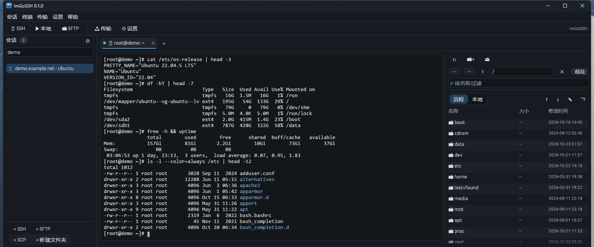

# ImGoSSH

用 **Rust** 实现的开源 SSH / SFTP / SCP 工作站：带会话侧边栏、多标签终端、右侧停靠的 SFTP 文件浏览器与隧道管理的原生图形客户端，外加三个与 OpenSSH 用法对齐的命令行工具 `igssh` / `igscp` / `igsftp`。

> An open-source SSH / SFTP / SCP workstation written in Rust — a native `egui` GUI plus three OpenSSH-style CLI tools, all built on one connection engine.

[](LICENSE)




GUI 与 CLI 共用同一套引擎（`src/ssh` + `src/terminal`），因此行为、主机密钥库和会话配置完全一致——图形界面里能做的事，命令行里都能脚本化。

**目录**

- [纯 Rust 技术栈](#纯-rust-技术栈)
- [为什么用 Rust 写 SSH 客户端](#为什么用-rust-写-ssh-客户端)
- [功能](#功能)
- [快速开始](#快速开始)
- [界面导览](#界面导览)
- [命令行工具](#命令行工具)
- [快捷键](#快捷键)
- [终端能力](#终端能力)
- [配置与数据文件](#配置与数据文件)
- [架构与代码结构](#架构与代码结构)
- [测试](#测试)
- [参与贡献](#参与贡献)
- [安全说明与已知限制](#安全说明与已知限制)
- [开源协议](#开源协议)

---

## 纯 Rust 技术栈

SSH 家族协议由本项目自己实现：**不 fork、不调用、也不需要安装 OpenSSH**，没有 Electron、没有 WebView、不捆绑任何脚本运行时。

| 层 | 依赖 | 承担的工作 |
| --- | --- | --- |
| 协议与密码学 | `russh` 0.64（`ring` 后端） | 密钥协商、认证、channel、转发 |
| 文件传输 | `russh-sftp` 3.0 | SFTP 子系统，而非 scp 协议 |
| 异步运行时 | `tokio` 1 | 一条连接上并发多 channel，UI 线程永不阻塞 |
| 终端仿真 | `vt100` 0.16 | 屏幕缓冲、光标、滚动、转义序列 |
| 本地伪终端 | `portable-pty` 0.9 | Windows 上是 ConPTY，类 Unix 上是 PTY |
| 图形界面 | `egui` / `eframe` / `egui_extras` 0.36 | 即时模式 GUI，三平台同一份代码 |
| 命令行 | `clap` 4 + `crossterm` 0.28 + `rpassword` 7 | 参数解析、TTY 提问、进度条 |
| 持久化 | `serde` + `toml` 0.9 | 会话树、主题与设置 |

与 OpenSSH 的互操作只体现在数据格式上：主机密钥库 `known_hosts` 就是 OpenSSH 的文本格式，私钥直接吃 OpenSSH 格式，`~/.ssh/` 里的东西可以原样复用。

## 为什么用 Rust 写 SSH 客户端

- **边界内的协议解析。** 转义序列、`known_hosts` 匹配、DEC 特殊图形字符集这些都要在不可信输入上切片，Rust 的借用检查把「越界写进屏幕缓冲」这条路直接堵在编译期。
- **并发是免费的。** 一条 TCP 连接上同时挂交互 shell、SFTP 与三类隧道，靠的是 `tokio` 任务加 `mpsc` 消息，而不是线程加锁；`russh` 的 `client::Handle` 不可 `Clone`，这个约束反而把架构定型成清晰的 actor 模型（见[架构与代码结构](#架构与代码结构)）。
- **一份代码，四种产物。** `imgossh` 图形程序与 `igssh` / `igscp` / `igsftp` 三个 CLI 共用同一个库 crate，不存在「GUI 能连、CLI 连不上」这类分叉。
- **产物就是一个可执行文件。** 不用装运行时、不用带 DLL、不下载 npm 包，release 目录里的四个 exe 拷走即用。
- **即时模式 GUI 天生适合终端。** 每帧重画，状态灯、传输进度条、服务器实时指标胶囊这些高频刷新项不需要任何脏标记与手动失效逻辑。

---

## 功能

- **会话管理**：左侧树形面板保存 SSH / SFTP / SCP 与本地终端会话，支持文件夹分组、实时搜索、右键新建 / 重命名 / 删除
- **多标签终端**：`vt100` 仿真加 Windows ConPTY 本地 shell，支持鼠标上报、OSC 52 剪贴板、窗口标题、响铃与回滚缓冲
- **内嵌 SFTP 浏览器**：停靠在终端右侧，远端与本地双栏并排，拖拽即可上传下载；空白处右键刷新 / 新建目录 / 上传文件，文件右键可另存下载、重命名、删除、查看属性并直接改权限
- **传输队列**：走 SFTP 子系统而非 scp 协议，字节数精确，带阶段进度条、实时速率与取消
- **SSH 隧道**：本地 `-L`、远端 `-R`、动态 SOCKS5 `-D` 三类隧道，图形界面与命令行都能建
- **认证**：密码、公钥、键盘交互，外加 ssh-agent 与 Pageant；主机密钥用 OpenSSH 格式的 `known_hosts`，与 `~/.ssh/known_hosts` 双向互通
- **服务器实时指标**：CPU、内存、交换分区、上下行速率、运行时间、登录用户与各挂载点使用率，每 2 秒采样（`src/ssh/monitor.rs`），可在设置里关掉
- **配色与字体**：ImGo Dark、ImGo Light、Xterm 三套调色板，16 / 256 色与 24 位真彩色，服务器还能用 `OSC 4/10/11/12` 临时改色
- **中英双语界面**：语言默认跟随系统，切换即时生效，无需重启
- **可复用配置**：`config.toml` + `sessions.toml` 纯文本，`IMGOSSH_HOME` 指到 U 盘就是便携版

---

## 快速开始

### 下载二进制

到 [Releases](https://github.com/0alexwu0/ImGoSSH/releases/tag/v0.1.0) 取对应平台的包，每个都含 `imgossh` 图形主程序、`igssh` / `igscp` / `igsftp` 三个命令行工具，以及 `LICENSE` 与 `README.md`；发布说明里列出了每个包的 SHA-256，下载后可自行校验。

| 平台 | 包 | 形式 |
| --- | --- | --- |
| Windows x86-64 | `ImGoSSH-0.1.0-windows-x64.zip` | 免安装，解压即用 |
| Linux x86-64 | `ImGoSSH-0.1.0-linux-x86_64.tar.gz` | `tar xzf` 后直接运行 |
| macOS（Apple Silicon） | `ImGoSSH-0.1.0-macos-aarch64.zip` | 未签名，见下方说明 |
| macOS（Intel） | `ImGoSSH-0.1.0-macos-x86_64.zip` | 未签名，见下方说明 |

Linux 包不依赖 GTK：二进制只硬链接 `glibc`，X11 / Wayland 后端与文件对话框（`xdg-desktop-portal`）都在运行时按需加载，主流桌面发行版开箱即用。macOS 包没有开发者证书签名与公证，首次运行会被 Gatekeeper 拦下，在「系统设置 → 隐私与安全性」点「仍要打开」，或者对解压出来的目录执行 `xattr -dr com.apple.quarantine <目录>`。

### 从源码构建

环境：Rust 1.85 以上，Windows 10 / 11（stable-msvc）。Linux 与 macOS 同样可编译，本地终端后端会自动切到对应的 PTY 实现；Linux 只需要 Rust 工具链和一个 C 编译器（`build-essential`），不需要 GTK 或 X11 开发包——相关运行库都是运行时才加载的；macOS 需要 Xcode 命令行工具。三平台的构建与测试见 `.github/workflows/release.yml`。

```powershell
git clone https://github.com/0alexwu0/ImGoSSH.git
cd ImGoSSH

cargo run                       # 直接起 GUI
cargo run -- --local            # 启动就开一个本地终端标签
cargo run -- root@192.0.2.10    # 启动即连接指定主机
cargo run -- --session "Clients/Production"   # 打开已保存的会话

cargo build --release           # 发布构建，产物在 target/release/
cargo build --release --target x86_64-apple-darwin   # 例：Apple Silicon 上另出 Intel 包
```

四个可执行文件：

| 名称 | 作用 |
| --- | --- |
| `imgossh` | 图形主程序 |
| `igssh` | OpenSSH 风格客户端，交互 shell 或单条命令 |
| `igscp` | 本机与远端之间的文件拷贝 |
| `igsftp` | 交互式 SFTP 提示符 |

Windows 上构建 release 时，`build.rs` 会把 `src/icon.rs` 现画的图标拼成 16–256px 多尺寸 `.ico`，用 Windows SDK 的 `rc.exe` 编成资源链进 `imgossh.exe`。找不到 `rc.exe` 只报一条 `cargo:warning` 并保留系统默认图标，不会让构建失败；也可以把 `IMGOSSH_RC` 指向 `rc.exe` 的完整路径手工指定。

---

## 界面导览

整套界面由一份设计令牌绘制（`src/ui/theme.rs`）：深色磨砂面板、圆角卡片、发丝描边、克制的蓝色强调色，以及「运行中 / 连接中 / 出错 / 已停止」四色状态灯。ImGo（默认）、Dark、Light 三套主题共用同一份令牌，切换即时生效。

主窗口自上而下：

- **菜单栏 / 工具栏**：会话、终端、传输、设置、帮助；新建本地终端、新建 SSH / SFTP 会话、传输队列（带计数徽标）、设置
- **欢迎页**：品牌卡片加三张入口卡片（本地终端 / SSH 会话 / 设置），悬停时亮起强调色描边
- **左侧会话面板**：会话计数徽标与齿轮按钮、`⌕` 搜索框、整行高亮的树形列表——已连上的会话会被点亮成强调色；底部是 `+ SSH`、`+ SFTP`、`+ SCP`、`+ 新建文件夹`
- **标签区**：手绘标签，含状态灯、协议图标、悬停时现身的关闭按钮与当前标签的强调色下划线；点 `✕` 与状态栏「断开连接」走同一条路径，断开并关闭标签
- **终端**：嵌在一圈留白之后的圆角凹槽里，与面板其余部分明显分层，配色沿用所选调色板
- **SFTP 浏览器**：宽度足够时左远端右本地双栏并排，窄面板自动切成 远程 / 本地 分段单栏；各有 `←` `→` `↑` 历史导航与可编辑路径框，空白处右键弹出 刷新 / 新建文件夹 / 上传文件，行上右键按类型给出 打开 / 下载 / 重命名 / 删除 / 属性；上传下载在列表上方显示进度条（阶段、已传 / 总量、速率、可取消），完成后自动刷新；下载默认询问保存位置，属性窗口显示大小与创建 / 修改 / 访问时间并能用八进制或 `rwx` 勾选直接改权限
- **会话编辑器**：会话 / 隧道 / 高级 SSH 设置分段控件；密码带 👁 显隐与「保存密码」开关
- **状态栏**：状态灯、连接状态、`user@host`、终端行列、断开按钮，加上服务器实时信息——主机名、CPU、内存、交换分区、上下行速率、运行时间、登录用户与各挂载点使用率，全部做成胶囊进度条，数值越界才转黄转红

界面语言支持**英文**与**简体中文**，默认跟随系统（Windows 读 `GetUserDefaultUILanguage`，其它平台读 `LC_ALL` / `LANGUAGE` / `LANG`），可在 设置 → 语言 随时切换并写入 `config.toml`。实现见 `src/i18n.rs`：英文原文本身就是查找键，表里没有的词条自动回落成英文，新增文案不会让界面出现空洞。

---

## 命令行工具

### igssh

```sh
igssh root@192.0.2.10
igssh -l deploy -p 2222 -i ~/.ssh/id_ed25519 build-server
igssh host -e "uptime -p"                 # 执行一条命令后退出
igssh --exec host -e "df -h"              # 不分配 PTY，直接捕获 stdout 与 stderr
igssh -L 8080:localhost:80 -D 1080 jump   # 本地转发 + SOCKS5 代理
igssh -R 9000:localhost:22 bastion        # 反向转发
igssh -w -a host                          # 强制询问密码，并禁用 agent
```

常用参数：`-l 用户`、`-p 端口`、`-i 私钥`、`-e 命令`、`-L/-R/-D 转发`、`-w 询问密码`、`-a 不用 agent`、`--keepalive 秒数`、`--term 值`。

### igscp

```sh
igscp ./app.tar.gz deploy@192.0.2.10:/srv/uploads/
igscp -r user@host:/var/log ./logs
igscp -P 2222 -i ~/.ssh/id_ed25519 a.txt b.txt user@host:/tmp/
igscp user@host:/tmp/a.log ./renamed.log   # 目标不是目录时视为重命名
igscp -q host:/etc/hosts ./hosts           # 静默，不打印进度
```

### igsftp

```sh
igsftp user@host:/var/log
igsftp -P 2222 -i ~/.ssh/id_ed25519 host
igsftp -o "ls -l" -o "get app.log" host    # 脚本化执行后退出
igsftp -b batch.txt host                   # 从文件读取命令
```

内置命令：`ls [-l]`、`cd`、`pwd`、`lpwd`、`lcd`、`get`、`put`、`mkdir`、`rmdir`、`rm`、`rename`、`stat`、`local 命令`、`help`、`bye`。

---

## 快捷键

应用自己的快捷键一律是 `Ctrl+Shift` 或 `Alt` 组合，裸 `Ctrl` 完整留给 shell（`Ctrl+A` 行首、`Ctrl+E` 行尾、`Ctrl+W` 删词、`Ctrl+T` 转置、`Ctrl+L` 清屏、`Ctrl+R` 反向搜索、`Ctrl+U` 删到行首……）；`Tab`、方向键和 `Esc` 也不会被界面抢去做焦点导航。

| 按键 | 作用 |
| --- | --- |
| `Tab` / `Shift+Tab` | 远端 shell 的正向 / 反向补全 |
| `Ctrl+Shift+T` | 新建本地终端标签 |
| `Ctrl+Shift+N` | 新建会话 |
| `Ctrl+Shift+R` | 重新连接当前标签 |
| `Ctrl+Shift+W` | 关闭当前标签（同时断开该会话） |
| `Ctrl+Shift+C` / `Ctrl+Insert` | 复制选中内容 |
| `Ctrl+Shift+V` / `Shift+Insert` | 粘贴 |
| `Ctrl+Tab` / `Ctrl+Shift+Tab` | 下一个 / 上一个标签 |
| `Alt+1` … `Alt+9`、`Alt+0` | 跳到第 N 个标签 |
| `Alt+Left` / `Alt+Right` | 上一个 / 下一个标签 |
| `Ctrl+Shift+B` | 显示 / 隐藏 SFTP 浏览器 |
| `Ctrl+Shift+H` | 显示 / 隐藏侧边栏 |
| `Ctrl+Shift+S` | 打开设置 |
| `Ctrl+Shift+U` | 打开传输队列 |

其余按键按 xterm 约定原样转义：`Home`/`End`、`PgUp`/`PgDn`、`Insert`/`Delete`、`F1`–`F12`、`Alt+字母`（readline 按词移动），以及应用光标模式下的方向键 `CSI`。

---

## 终端能力

- **鼠标**：选择与拖拽复制、`Shift+PgUp` / `Shift+PgDn` 翻回滚，以及鼠标上报——vim、htop、tmux 可以直接用鼠标操作
- **右键菜单**：复制 / 粘贴 / 全选 / 滚到底部 / 切换 SFTP 浏览器 / 关闭标签，点中某项、菜单外按下或 `Esc` 都在当帧关闭，焦点同时交还终端；菜单浮在网格之上，因此点菜单不会取消选区，复制不会落空
- **真彩色**：16 色、256 色（`SGR 38;5;n`）与 24 位真彩色（`SGR 38;2;r;g;b`），粗体自动提亮到亮色，暗色 / 斜体 / 下划线 / 反显同样生效；服务器可用 `OSC 4` / `10` / `11` / `12` 临时改写调色板项、默认前景、背景与光标色，`OSC 104` / `110` / `111` / `112` 复位，`OSC 10;?` / `11;?` 查询会回答改过之后的颜色；切主题或重连会清掉服务器留下的改动。SSH 会话建好伪终端后会申请 `COLORTERM=truecolor`
- **制表符翻译**：服务器在没有 UTF-8 locale 的机器上画边框时，会用 VT220 特殊图形字符集（`ESC ( 0`）把线条当字母发过来——`lqqqqqqk` 其实是 `┌──────┐`，`x` 是 `│`。`src/line_drawing.rs` 在字节进入 vt100 之前就把这套字符集翻译成真正的 Unicode 制表符与阴影块，所以屏幕、回滚缓冲和复制出来的文本都是能直接用的 `─`、`│`、`┼`。`ESC ) 0` 右侧字符集、`SO`/`SI` 切换同样支持，`ESC ( B` 与 `RIS` 复位回 ASCII，OSC / DCS / APC / CSI 内部的字节不会被误翻译。`nvtop`、`htop`、`whiptail` 在 `LANG=C` 下的边框就是靠它正常的

---

## 配置与数据文件

全部位于 `%APPDATA%/ImGoSSH/`（Windows）、`~/.config/ImGoSSH/`（Linux）、`~/Library/Application Support/ImGoSSH/`（macOS）。

| 文件 | 内容 |
| --- | --- |
| `config.toml` | 主题、配色、字体、回滚行数、默认会话参数、窗口状态 |
| `sessions.toml` | 会话树，含文件夹、隧道、启动脚本 |
| `known_hosts` | 主机密钥库，OpenSSH 格式 |

主机密钥会同时读取 `~/.ssh/known_hosts`：在这里接受的密钥 OpenSSH 也认，反之亦然。匹配遵循 OpenSSH 语义，支持 `host,*.example.com` 逗号列表与 `!取反`。

想把数据放到别处（例如 U 盘里的便携目录），设置 `IMGOSSH_HOME` 即可覆盖默认路径，会话、主题和已接受的主机密钥都会跟着走。

会话文件片段：

```toml
[[sessions]]
name = "Production"
folder = "Clients"
protocol = "ssh"
host = "192.0.2.10"
port = 22
username = "root"
private_key = "C:/Users/me/.ssh/id_ed25519"
use_agent = true
sftp_panel = true
keepalive = 60
startup_script = "tmux attach || tmux"

[[sessions.tunnels]]
kind = "local"
listen_port = 8080
remote_host = "localhost"
remote_port = 80
```

调试日志：设置 `RUST_LOG=debug` 后启动。

---

## 架构与代码结构

三层结构，依赖方向单向：`ui` / `bin` → `ssh` / `terminal` → 第三方 crate。`ui` 只通过 `ssh::client::Connection` 与 `terminal::Emulator` 说话，从不反向依赖；`igssh` / `igscp` / `igsftp` 只用到 `cli` + `ssh` + `terminal`，完全不碰 `ui`，所以界面改版不会影响命令行行为。

关键设计有两条：

- **一连接一 actor。** `russh` 的 `client::Handle` 不可 `Clone`，所以每条连接由一个专属 tokio 任务持有句柄，UI 与其他通道通过可 `Clone` 的 `Connection` 发送命令。多个 shell、SFTP、隧道因此能共享同一条 TCP 连接，且 UI 线程永不被 IO 阻塞。
- **终端仿真与传输层解耦。** `TermSink` 回调把字节送进 `Emulator`，本地 ConPTY 与远端 SSH 走同一条路径，终端控件对二者一视同仁——本地终端标签和 SSH 标签是同一个控件。

```text
.github/workflows/   release.yml：Windows / Linux / macOS 三平台构建与测试
LICENSE              Apache-2.0 协议全文
build.rs             把 src/icon.rs 现画的图标拼成多尺寸 .ico，编进 imgossh.exe（非 Windows 目标直接跳过）
src/
  lib.rs              三层结构的入口
  main.rs             GUI 可执行文件，顺带把图标交给窗口与任务栏
  icon.rs             现画的应用图标：main.rs 与 build.rs 共用同一批像素
  bin/{igssh,igscp,igsftp}.rs
  cli.rs              CLI 共用：连接参数、TTY 提问线程、隧道解析、进度条
  config.rs           Session / Tunnel / Config / Store，TOML 持久化，主题与调色板
  i18n.rs             英文 / 简体中文词条表、系统语言探测、t! 宏
  terminal.rs         vt100 之上的 Emulator、查询应答、按键与鼠标编码
  line_drawing.rs     DEC 特殊图形字符集翻译成 Unicode 制表符，边框不再是一屏字母
  ssh/
    client.rs         连接 actor：认证、shell 与 exec、SFTP、三类隧道
    sftp.rs           目录列举、创建、删除、重命名
    transfer.rs       上传下载队列，进度、速率、取消
    local.rs          本地伪终端，Windows 上为 ConPTY
    hostkeys.rs       OpenSSH known_hosts 读写与匹配
    monitor.rs        服务器实时指标：CPU、内存、网络、磁盘、登录用户
  ui/
    app.rs            eframe::App：标签、模态框、tokio 运行时
    terminal.rs       终端控件，绘制屏幕并把 egui 输入编码成 PTY 字节
    sidebar.rs        会话面板
    browser.rs        SFTP 文件浏览器（宽屏双栏 / 窄面板单栏，含前进后退历史）
    dialogs.rs        会话编辑、设置、传输队列、认证弹窗
    theme.rs          设计令牌：三套主题的配色、间距、圆角与共用控件外观
tests/engine.rs       伪终端端到端与终端仿真测试
tests/live_server.rs  需要真实服务器的集成测试（默认 #[ignore]）
```

应用图标不依赖任何外部图片资源：`src/icon.rs` 用距离场按同一套强调色画出圆角瓦片，上半是 `>_` 提示符，下半是描边字形拼出的 `ImGoSSH` 铭牌，不依赖字体，128px 以上字样清晰、32px 以下退化成可读的色带而不是糊成一团。

---

## 测试

```powershell
cargo test --workspace
```

单元与仿真测试覆盖：主机密钥匹配（含通配与取反）、隧道解析、远端路径拼接、配置与调色板往返、终端仿真（DSR 与 DA 应答、标题、光标、回滚、服务器改色与颜色格式解析）、DEC 特殊图形字符集翻译（`ESC ( 0` 与 `ESC ) 0`、`SO`/`SI` 切换、控制串内部不误译、`RIS` 复位）、词条表与 `{0}` 模板替换、快捷键归属（裸 `Ctrl` 必须落到 shell，`Alt+字母` 不被界面截获）、界面几何（首页三个按钮确实居中、左右留白相等）、右键菜单的关闭时机（选中即关、菜单外按下即关、`Esc` 即关，唯独打开它的那一次右键不算），以及一个真实 ConPTY 端到端用例：启动本机 shell、应答 `CSI 6 n`、执行 `echo` 并断言屏幕出现结果。

### 真机测试

`tests/live_server.rs` 里的用例默认被 `#[ignore]` 屏蔽，指定一台真实 SSH 服务器后才会运行：shell 命令、SFTP 列目录与读写、上传下载队列往返（顺带验证远端目录不存在时会自动创建）、服务器实时指标采集、终端 `Tab` 补全（输入 `cat /tmp/imgoshtab` 按 `Tab`，断言补全出完整文件名、字符没有重复发送、回车执行的是补全后的命令），以及线条绘制用例（先打印一段 `ESC ( 0` 边框再跑 `nvtop`，断言屏幕上出现的是真正的制表符）。

```powershell
$env:IMGOSSH_TEST_HOST = "192.0.2.10"
$env:IMGOSSH_TEST_USER = "root"
$env:IMGOSSH_TEST_PASS = "你的密码"
$env:IMGOSSH_TEST_PORT = "22"   # 可选
cargo test --test live_server -- --ignored --nocapture --test-threads=1
```

这些用例会断言「引擎已经持有密码时绝不再次弹窗索要密码」，所以密码框一旦回归就会直接失败，而不是卡在无人可见的提示上。示例中的 `192.0.2.10` 是 RFC 5737 的文档地址，换成你自己的测试机即可。

---

## 参与贡献

Issues 和 Pull Request 都欢迎。动手前建议先开一个 Issue 说清问题与思路，避免重复劳动。

```powershell
cargo fmt --all --check
cargo clippy --all-targets
cargo test --workspace
```

- 提交前跑一遍上面三条，`fmt` 与 `clippy` 干净、测试全绿是合并的前提（真机用例可以跳过）。
- 一个 PR 只做一件事：修 bug 的 PR 里别夹带格式化，`cargo fmt` 的连带改动请单独提交。
- 新功能请带上测试，尤其是终端解析、主机密钥匹配、路径拼接这类纯逻辑代码。
- 新增文案请同时补 `src/i18n.rs` 的中文列——英文原文就是查找键，漏了只会回落成英文，不会崩。
- 提交信息用一句话说明「做了什么」，需要背景再写正文。
- 行为、配置格式或快捷键有变化时，请同步改这份 README。

---

## 安全说明与已知限制

**安全**

- **会话密码以明文保存在 `sessions.toml`**，文件本身不做任何加密。不要在共享机器上保存生产密码，优先使用私钥加 ssh-agent 或 Pageant。
- 首次连接会校验主机密钥并弹窗确认；指纹变化时给出警告并阻断，需要手动确认，以降低中间人风险。
- 传输走 SFTP 子系统而非 scp 协议，进度更精确，但要求服务端启用 `sftp-server`。

**已知限制**

- 只做 SSH 家族协议，不含 X11 转发与 RDP、VNC、FTP、Telnet、串口。
- 不支持两台远端主机之间的直接拷贝，即 `igscp host1:a host2:b`。
- 终端不支持连字（ligature）字体；界面会自动回退到系统的 Segoe UI Symbol 与中文字体，因此箭头、图标和中文输出都能正常显示。
- 词条表目前覆盖英文与简体中文；其它语言会回落到英文，往 `src/i18n.rs` 的表里加一列即可扩展。
- 文件浏览器不会跟随终端里的 `cd`：这需要服务端上报 `OSC 7`，目前尚未实现。
- 图形界面主要在 Windows 上开发与验证。Linux 与 macOS 包会跑通全部单元 / 仿真测试，但界面细节（字体回退、剪贴板、本地伪终端）还没在桌面环境里系统性回归过，遇到问题欢迎开 Issue。

---

## 开源协议

ImGoSSH 以 **Apache License 2.0** 开源，协议全文见仓库根目录的 `LICENSE`，`Cargo.toml` 里的 `license` 字段同样是 `Apache-2.0`。

| 事项 | 说明 |
| --- | --- |
| 能做什么 | 自由使用、研究、修改、分发，也可以并进闭源的商业产品，不要求公开你的改动 |
| 要留什么 | 分发源码或二进制时附上 `LICENSE` 全文，保留原有的版权、许可与免责声明，并标注你改过哪些文件 |
| 专利 | 协议第 3 条随许可证一并授予专利授权；若就本项目提起专利侵权诉讼，所获专利授权同时终止 |
| 贡献 | 提交到本项目的代码在提交时即按同一协议授权给所有使用者，无需另签 CLA（协议第 5 条） |
| 担保 | 软件按「现状」提供，不含任何明示或默示担保，作者不承担适用法律允许范围内的责任 |

第三方组件各自保持原有协议，不因本仓库而改变。已核对的主要几个：`egui` / `eframe` / `clap`（MIT 或 Apache-2.0，任选其一）、`russh` / `russh-sftp`（Apache-2.0）、`tokio` / `vt100` / `portable-pty`（MIT）、`ring`（Apache-2.0 与 ISC）。分发二进制时请连同全部依赖的协议文本一起附上，装好 `cargo-license` 后一条命令即可列出：

```powershell
cargo install cargo-license
cargo license
```

---

## 作者

**Alex.Wu** — ImGoSSH 的设计与实现。

Copyright 2026 Alex.Wu. 保留所有权利（Apache-2.0 协议下授权）。